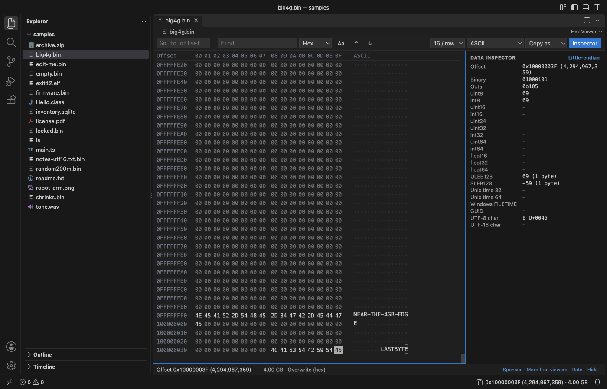
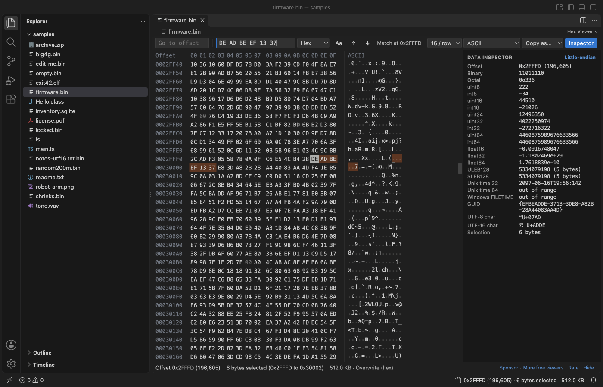
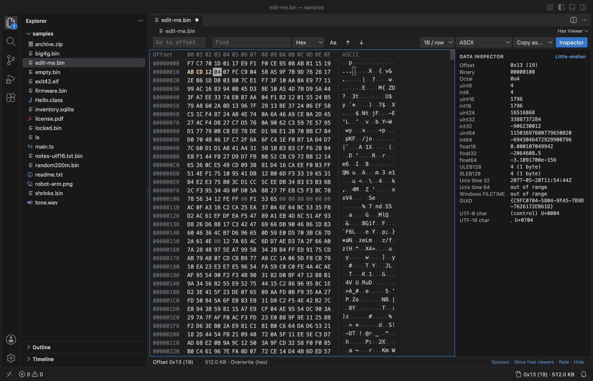
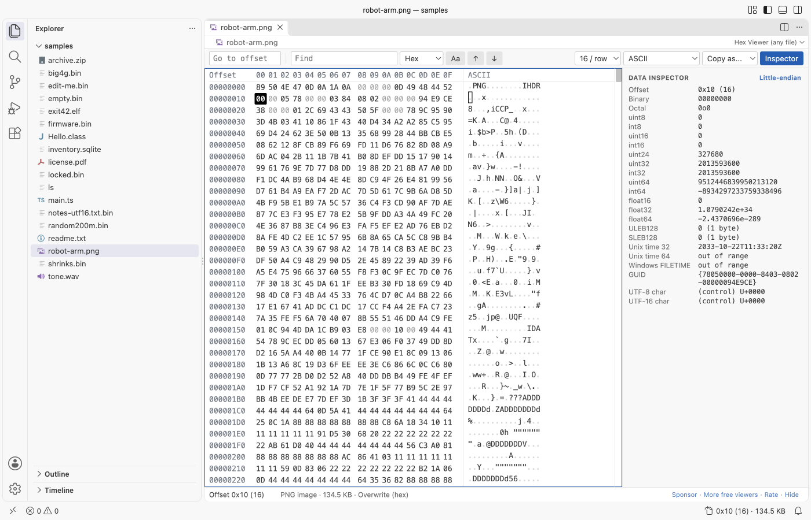

# Hex Viewer & Binary Viewer, Hex Editor (Large Files)

Free, no sign-in, works offline. See and edit the bytes of any file in VS Code, from a 0-byte file to a 4 GB disk image. Insert and delete bytes, compare two files byte by byte, go to an offset, search, read values in the data inspector and copy as hex, C array, Python bytes or base64. An optional Pro add-on reads file formats with binary templates (see [Free and Pro](#free-and-pro)).

*Real output from VS Code 1.142 on macOS. The file is `robot-arm.png`. `scripts/e2e-vscode.mjs` installed the packaged extension in a clean VS Code profile, opened the file and saved the window through the debug port.*

- Big files open at once. Only the rows on screen are read, in 64 KB pieces. In the release check a 4 GB file opened in 0.6 s, Ctrl+End went to its last byte, and the extension host used 127 MB.
- You can get anywhere. Go to an offset in hex or decimal, or jump by `+0x100` or `-16`. Find hex bytes with `??` wildcards, text, or UTF-16 text. The status bar shows the offset of the cursor.
- Editing stays put. Type two hex digits to overwrite a byte, or press Insert to add bytes. Delete, cut and paste work on any selection. Every step can be undone.
- Compare two files. Select two files in the Explorer and pick "Compare in Hex Viewer". F7 jumps to the next difference, also in two 4 GB files.
- Structure view, free at the top level: binary templates read ELF, PE, Mach-O, UF2, device tree, U-Boot uImage, Android boot.img, WebAssembly, DEX, PNG, ZIP, PDF, SQLite and 13 more formats.
- Pro, if you want it: the nested fields of every template (ELF symbols and dynamic table, PE imports and resources, and more), bookmarks with notes, checksums, a compare report and find in many files. Each Pro feature has 3 free tries. Zovo Pro is USD 19 once for every Zovo viewer.

## Quick start

1. Install Hex Viewer.
2. Right-click any file in the Explorer and pick "Open in Hex Viewer". Files that end in `.bin`, `.dat`, `.img`, `.rom`, `.dmp` or `.dump` open in Hex Viewer when you click them.

For a file that is already open, use "Open in Hex Viewer" in the editor title menu (`...`) or the tab's right-click menu, or "Reopen Editor With...". Text files such as `.txt`, `.ts` and Intel `.hex` files still open in the text editor. "Hex Viewer: Get Started" in the Command Palette opens a short tour.

## Large files

- Local files of any size open. The extension never reads the whole file: it reads the rows you look at, and Find reads the file in 1 MB pieces.
- The scroll bar is drawn by the viewer, so it reaches the last row of a 4 GB or larger file. Drag it, use the mouse wheel, Page Up and Page Down, or Ctrl+Home and Ctrl+End.
- If the file changes on disk while it is open, the view shows the new bytes. If it got shorter, a message gives the old and new size and the view moves to the new end. Nothing crashes and nothing goes blank.
- Empty files and files you have no permission to read show a plain message instead of a blank tab.
- Files on remote and virtual file systems open up to 256 MB (setting `hexViewer.maxRemoteMB`).

## Find, go to and copy

| Action | Keys | Notes |
|---|---|---|
| Go to offset | Ctrl+G (Cmd+G) | `0x1F40`, `1F40h`, `8000`, `+0x100`, `-16`, `end`, `end-15`. Also the box at the left of the toolbar, and a click on the status bar. |
| Find | Ctrl+F (Cmd+F) | Hex `50 4B 03 04` with `??` for any byte, text (with Aa to ignore case) or UTF-16. Unsaved edits are found too. |
| Next, previous match | Enter, Shift+Enter, F3, Shift+F3 | The search goes on from the start after the end. Esc stops a long search. |
| Copy | Ctrl+C (Cmd+C) | Hex with spaces from the hex column (setting `hexViewer.copyFormat`), text from the text column |
| Copy as... | toolbar | Hex, hex with spaces, C array, Python bytes, base64, UTF-8 text, Latin-1 text. Up to 32 MB. |
| Select | Shift + arrows, Page Up, Page Down, Home, End; drag; Ctrl+A | |
| Switch column | Tab | Between the hex and the text column |

## Data inspector

The panel on the right reads the bytes at the cursor, or at the start of the selection, as:

- the offset in hex and decimal, binary and octal
- uint8, int8, uint16, int16, uint24, uint32, int32, uint64, int64
- float16, float32, float64
- ULEB128 and SLEB128, with their length
- Unix time (32 and 64-bit) and Windows FILETIME
- a GUID, and a UTF-8 and UTF-16 character with its code point

Click "Little-endian" to switch to big-endian. In the release check, the values at 5 offsets were the same as Python's `struct` and `uuid` modules.

## Edit bytes

- Type hex digits in the hex column, or characters in the text column. New bytes are colored until you save.
- Overwrite or insert. The status line shows the mode; press Insert or click the mode to switch. In insert mode, typed and pasted bytes go in before the cursor and the file grows. The cursor can sit one place past the last byte, to add bytes at the end.
- Delete removes the selected bytes, or the byte at the cursor. In insert mode Backspace removes the byte before the cursor. Ctrl+X cuts (copies, then removes) the selection.
- Paste hex (`4A 5B 00`, `0x4A, 0x5B` or `\x4a\x5b`) with Ctrl+V. In insert mode a paste replaces the selection.
- "Hex Viewer: Insert Bytes..." adds a run of bytes at the cursor, such as `16`, `0x100 FF` or `4 x 00`.
- Ctrl+Z undoes, Ctrl+Shift+Z redoes, and Ctrl+S saves. Inserting into or deleting from a 4 GB file takes no time, because only a list of changes is kept until you save.
- Safe save. If the size stays the same, only the changed bytes are written, so a save on a 4 GB file is fast. If the size changes, Hex Viewer writes a new copy in the same folder and then puts it in place of the old file, so a full disk or a crash never leaves a half-written file. Before that, it checks the free disk space and says how much it needs. A symbolic link stays a link. Save As writes a full copy.
- Read-only files open as view only. Set `hexViewer.readOnly` to turn editing off for every file.

## Compare two files

- Select two files in the Explorer, right-click and pick "Compare in Hex Viewer". With one file, the command asks for the second one. The "Compare..." button in the viewer toolbar compares the open file with another.
- The two files show side by side with one offset column. Differing bytes are colored in both. Bytes past the end of the shorter file count as different.
- F7 goes to the next difference and Shift+F7 to the previous one (also the buttons in the toolbar). A run of differing bytes counts as one area, so F7 skips to the next area.
- The toolbar counts every differing byte and area, and the scroll bar marks where they are. In the release check, two 4 GB files with one differing byte 64 bytes from the end were counted in 2.1 s (VS Code 1.90.2 on an Apple silicon Mac), with the extension host at 96 MB.
- The compare reads the files as saved on disk, 1 MB at a time from each file.

## Free and Pro

Everything above is free and stays free, in this version and every later one: viewing files of any size, go to offset, find, copy as, the data inspector, editing with insert and delete, safe save, undo, and compare. Hex Viewer Pro adds tools for people who take file formats apart. Each Pro feature works 3 times on your computer without a key, so you can try it on your own files first.

| | Free | Pro |
|---|---|---|
| View, find, go to offset, copy as, data inspector | yes | yes |
| Edit, insert and delete bytes, safe save, undo | yes | yes |
| Compare two files side by side, F7 to the next difference | yes | yes |
| Structure view, top level: the root and its fields for all 26 built-in templates and your own | yes | yes |
| Structure view, nested fields (ELF symbols and dynamic table, PE imports and resources...), export as JSON or C | 3 tries | yes |
| Bookmarks with a name, a color and a note, saved per file, export as Markdown | 3 tries | yes |
| Checksums of the selection or file: CRC-32, Adler-32, MD5, SHA-1, SHA-256, SHA-512 | 3 tries | yes |
| Compare report: every differing range to a text, CSV or JSON file | 3 tries | yes |
| Find bytes or text in many files | 3 tries | yes |

### Structure view (binary templates)

Open the Structure tab in the side panel. Hex Viewer picks the template that fits the file from its first bytes and shows the fields as a tree: name, value, enum name, offset and size. Click a field to select its bytes in the grid. The tree reads unsaved edits too, and reads the file again after you type.

The top level of the tree is free and uses no try: the file's main fields and the size of each table. A field that holds more fields shows one row, such as "14 nested fields: Zovo Pro". A click on that row uses one of the 3 free tries and opens every level in that tab, so you can test it on your own files first.

The 26 built-in templates:
- Firmware: UF2, device tree blob (DTB, DTBO), U-Boot uImage, Android boot.img.
- Code: ELF (with symbol and dynamic tables), PE: EXE, DLL, SYS (with imports and resources), Mach-O (also universal binaries), WebAssembly, Android DEX, Java class.
- Files: PNG, JPEG, GIF, BMP, ICO and CUR, TIFF (also DNG and many camera raw files), WebP, WAV, FLAC, MP4, MOV, M4A and HEIC boxes, ZIP (also JAR, APK, DOCX, XLSX, EPUB), GZIP, TAR, PDF (header, xref table and trailer), SQLite header, PCAP.

- "Template..." reads the file with another template. The choice is kept for that file.
- "JSON" and "C struct" open the selected struct (or the whole file) in a new editor: the values as JSON, or packed C structs with an initializer that holds the values.
- Your own templates: JSON files in the `.vscode/hex-templates` folder of the workspace, or in folders from the setting `hexViewer.templateFolders`. A template is data, never code: it names fields, types (u8 to u64, i8 to i64, f32, f64, bytes, char, string, zstring, LEB128 and more), counts, conditions, switches, enums and flags, and offsets that can be expressions such as `header.offset + 16`. [TEMPLATES.md](https://github.com/theluckystrike/hex-viewer-vscode/blob/HEAD/TEMPLATES.md) explains the format; the built-in templates in the `templates` folder are examples.
- Limits keep a broken file or template from hanging VS Code: 50,000 fields, 15 seconds, 100,000 items in one list. The tree says where it stopped and why.

### Bookmarks, checksums, report, find in files

- Bookmarks: select bytes and press Ctrl+F2 (Cmd+F2 on macOS), or use the Bookmarks tab. F2 and Shift+F2 jump to the next and previous bookmark. Bookmarks show as a colored line under their bytes and are saved per file on your computer. Bookmarks you have made stay yours: you can always view, edit and remove them.
- Checksums: the "Checksums..." button under the data inspector, or "Hex Viewer Pro: Checksums of Selection or File". One pass over the bytes, so a 4 GB file works. Pick a value to copy it.
- Compare report: "Export report" in the compare view writes every differing range with its offset, length and the first 16 bytes of both files, as text, CSV or JSON. The report is written as a stream, so two 4 GB files with many differences work.
- Find in files: "Hex Viewer Pro: Find Bytes in Files..." or right-click a folder in the Explorer. Hex bytes with `??` wildcards, text, text ignoring case, or UTF-16 text. The list shows each match with its offset and the bytes around it; pick one to open the file there.

### Getting Pro

The Pro features are part of Zovo Pro: USD 19 once, for life, and it unlocks the Pro features in every Zovo VS Code viewer. A team of 5 pays USD 59 once by PayPal and shares one key. When a Pro feature has no free tries left, its window has the buttons "Get Zovo Pro, USD 19", "Pay with PayPal" and "I already paid" (unlock with GitHub Sponsors or enter a license key). The Pro tabs have the buttons "Get Pro, USD 19", "PayPal" and "Unlock". One unlock turns on Zovo Pro in every Zovo extension on this computer.

With GitHub Sponsors:

1. "Get Zovo Pro, USD 19" (or the command "Zovo Pro: Get Zovo Pro") opens the ["$19 one time" tier](https://github.com/sponsors/theluckystrike/sponsorships?tier_id=679878) on GitHub Sponsors in your browser. Pay there.
2. Come back to VS Code. Hex Viewer asks once whether you paid; choose "I already paid", then "Unlock with GitHub Sponsors" (also the command "Zovo Pro: I already paid: unlock with GitHub Sponsors"). VS Code asks you to sign in with GitHub, and Hex Viewer asks GitHub one question: has this account bought the Zovo Pro tier? A monthly sponsorship of USD 10 or more also works while it runs. The "$15 one time" and "$5 a month" tiers on the same page are for Obsidian plugins and do not include Zovo Pro.

With PayPal (no GitHub payment needed):

1. "Pay with PayPal" (or the command "Zovo Pro: Pay for Zovo Pro with PayPal") shows the steps and opens PayPal with the amount filled in: [USD 19 for one person](https://www.paypal.com/paypalme/najzzz/19USD) or [USD 59 for a team of 5](https://www.paypal.com/paypalme/najzzz/59USD).
2. Send the transaction ID from the PayPal receipt with the [Zovo Pro key form](https://github.com/theluckystrike/zovo-plugin-factory/issues/new?template=zovo-pro-key.yml) on GitHub. The form is public, so post only the ID. No GitHub account? Write "Zovo Pro" in the PayPal note instead.
3. The license key (it starts with ZOVO1.) comes to the email address of your PayPal account. Paste it with "Zovo Pro: Enter Zovo Pro license key". The key is checked on your computer and kept in VS Code's secret storage.

"Zovo Pro: Remove Zovo Pro from this editor" removes it.

Nothing about Pro shows up on its own: there is no popup when a file opens, no counter and no reminder. A Pro feature explains itself only when you click it after its free tries. After you click "Get Zovo Pro, USD 19" or a PayPal button, one short message asks, when you are back in VS Code, whether you want to finish the unlock. It shows once, within 2 hours of the click, and not at all if Pro is already on.

## Display

- 8, 16, 24, 32, 48 or 64 bytes per row.
- Text column in ASCII, Latin-1, UTF-8, UTF-16 LE, UTF-16 BE or EBCDIC (code page 037). Control bytes show as a dot or as symbols such as ␀ and ␊.
- The file type from its first bytes in the status line: PNG, JPEG, ZIP, PDF, SQLite, ELF, Mach-O, PE, Java class, WAV, WebAssembly and more.
- The editor font, the theme colors in dark and light themes, and the editor font size (or `hexViewer.fontSize`).
- Screen readers hear the offset and value of the byte under the cursor.

## Settings

| Setting | Default | What it does |
|---|---|---|
| `hexViewer.bytesPerRow` | 16 | Bytes in each row when a file opens |
| `hexViewer.encoding` | ascii | Text column encoding when a file opens |
| `hexViewer.controlChars` | dot | Show control bytes as a dot or as symbols |
| `hexViewer.uppercase` | true | 4A or 4a |
| `hexViewer.fontSize` | 0 | Font size of the byte grid; 0 uses the editor font size |
| `hexViewer.copyFormat` | hexSpaced | What Ctrl+C copies from the hex column |
| `hexViewer.littleEndian` | true | Byte order of the data inspector |
| `hexViewer.showInspector` | true | Show the data inspector when a file opens |
| `hexViewer.readOnly` | false | Turn off byte editing |
| `hexViewer.maxRemoteMB` | 256 | Largest file from a remote or virtual file system |
| `hexViewer.askForRating` | true | Ask for a rating after 2 files opened without an error in 2 sessions at least 4 hours apart. "Rate it" opens the Marketplace review page in VS Code and the Open VSX one in Cursor, Windsurf and VSCodium. "Later" asks one more time after 7 days, "No thanks" never again. It never asks after an error. Turn it off with `false`. |
| `hexViewer.showSupportLinks` | true | Show the small Sponsor and More free viewers links in the status line |
| `hexViewer.templateFolders` | [] | Folders with your own binary templates for the Structure view (Pro) |
| `hexViewer.showProFeatures` | true | Off: hide the Pro badges, tabs, buttons and commands, so you see only the free viewer. With a Zovo Pro license they always show |

## Privacy and safety

The extension has no telemetry and makes no network calls, except one call to GitHub when you choose "Unlock Zovo Pro with GitHub Sponsors". A monthly sponsor gets one silent recheck every 30 days. A license key is checked on your computer. An unlock is also saved in `~/.zovo/pro.json` (readable only by you: the key, or the GitHub login and tier, never a token), so the other Zovo extensions on this computer turn Pro on without a second unlock. "Get Zovo Pro", the PayPal buttons and the key form open pages in your browser. The extension writes to a file only when you save, or when you save a compare report. Templates are read as data and never run as code. The webview runs under a strict Content Security Policy (`default-src 'none'`, scripts by nonce, no remote sources) and gets bytes only from the extension host.

## Limits

- Copy as... works up to 32 MB, and a paste up to 16 MB.
- Bookmarks keep their offsets: an insert or delete before a bookmark does not move it.
- Templates read up to 16 MB from the end of a file when they search for a marker (as the ZIP and PDF templates do). The PDF template reads classic xref tables; an xref stream (PDF 1.5 and later) is named but not unpacked.

## Support Zovo

Zovo Pro: USD 19 once, every Zovo viewer. [Get Zovo Pro on GitHub Sponsors](https://github.com/sponsors/theluckystrike/sponsorships?tier_id=679878) to turn on the Pro tools in this extension and in the other Zovo extensions you use. The free features stay free.

Zovo extensions have no ads and no tracking. They are made by [theluckystrike](https://github.com/theluckystrike) on GitHub. You can also support the work with no Pro:

- [Sponsor on GitHub](https://github.com/sponsors/theluckystrike)
- [PayPal](https://www.paypal.com/paypalme/najzzz)
- [Follow theluckystrike on GitHub](https://github.com/theluckystrike)

### Need your format supported?

Open a [format request](https://github.com/theluckystrike/hex-viewer-vscode/issues/new?template=format-request.yml) with a sample file, and I reply there whether it can be done. For USD 299 once, through [this GitHub Sponsors tier](https://github.com/sponsors/theluckystrike/sponsorships?tier_id=679995), I add your file format or a missing feature to this extension, with tests, within 7 days.

## More tools by Zovo

- [ZIP Viewer & Archive Explorer (JAR, TAR, GZ)](https://marketplace.visualstudio.com/items?itemName=zovo.zip-archive-explorer) browses ZIP, JAR, VSIX, TAR and GZ files, opens entries in tabs and extracts them safely.
- [NPZ Viewer & NPY Viewer, PyTorch, GGUF & Safetensors (NumPy Viewer)](https://marketplace.visualstudio.com/items?itemName=zovo.tensor-viewer) shows NPY, NPZ, Safetensors and GGUF tensors with stats and heatmaps.
- [PCAP Viewer & PCAPNG Viewer (Packet Capture Analyzer)](https://marketplace.visualstudio.com/items?itemName=zovo.zovo-pcap-viewer) opens PCAP and PCAPNG captures with a packet list, filters and a hex pane.
- [Linker Map Viewer & Map File Analyzer (GNU ld, Memory Usage)](https://marketplace.visualstudio.com/items?itemName=zovo.zovo-linker-map-viewer) shows FLASH and RAM use from GNU ld, lld, IAR and Keil map files.
- [VCD Viewer & Waveform Viewer (Verilog, No Signal Limit)](https://marketplace.visualstudio.com/items?itemName=zovo.zovo-vcd-waveform-viewer) opens Verilog, SystemVerilog and VHDL VCD waveforms with no signal limit.

See [all Zovo extensions on the Marketplace](https://marketplace.visualstudio.com/publishers/zovo).

## License

MIT
